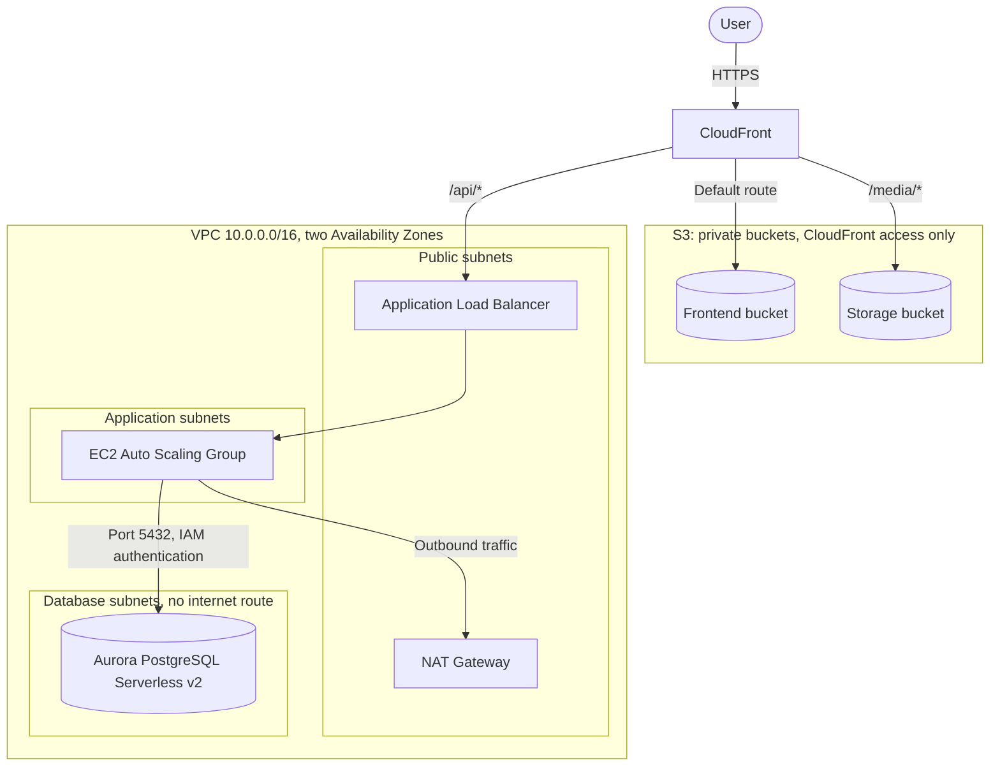

# Anwar Shah and Sons Infrastructure

Terraform code for a three-tier web application on AWS, made up of a CloudFront content delivery layer, an Auto Scaling application tier, and an Aurora PostgreSQL database. Changes are reviewed through pull requests, with a GitHub Actions workflow that runs `terraform plan` using short-lived OIDC credentials.

This repository contains infrastructure only. The application code lives elsewhere.

## Project Status

| Area | Status |
| --- | --- |
| `dev` environment | Plan passes in CI (52 resources to add). Not yet applied. |
| CI | Automated format, validate, and plan checks on pull requests |
| CD | Not yet implemented. Applies are run manually. |
| `staging` and `prod` | Planned |

## Architecture



### Components

| Module | Resources | Purpose |
| --- | --- | --- |
| [`vpc-network`](modules/vpc-network) | VPC, subnets, route tables, internet gateway, NAT gateway | Network foundation with separate public, private, application, and database subnets |
| [`app`](modules/app) | ALB, Auto Scaling Group, launch template, IAM role | Application tier on Ubuntu 24.04, running 1 instance with a maximum of 5, and rolling instance refreshes with automatic rollback |
| [`database`](modules/database) | Aurora PostgreSQL 17 cluster, writer and reader instances | Serverless v2 database that scales between 0.5 and 16 ACUs |
| [`frontend`](modules/frontend) | S3 bucket and bucket policy | Private origin for the frontend's static files |
| [`storage`](modules/storage) | S3 bucket and bucket policy | Private origin for media files |
| [`cloudfront`](modules/cloudfront) | CloudFront distribution, Origin Access Control | Single entry point that routes requests to the frontend, media, and API origins |

### Network Layout

Each tier has one subnet in each of the two Availability Zones.

| Tier | CIDR blocks | Internet access |
| --- | --- | --- |
| Public | `10.0.1.0/24`, `10.0.2.0/24` | Inbound and outbound through the internet gateway |
| Private (not used by any module yet) | `10.0.3.0/24`, `10.0.4.0/24` | Outbound only, through the NAT gateway |
| Application | `10.0.20.0/24`, `10.0.21.0/24` | Outbound only, through the NAT gateway |
| Database | `10.0.10.0/24`, `10.0.11.0/24` | None |

## Repository Structure

```text
.
├── .github/workflows/
│   └── plan.yml            # Terraform plan on pull requests
├── bootstrap/              # S3 bucket for remote state
├── environments/
│   └── dev/                # Composes the modules into the dev environment
└── modules/                # Reusable infrastructure modules
    ├── app/
    ├── cloudfront/
    ├── database/
    ├── frontend/
    ├── storage/
    └── vpc-network/
```

## Security

- **No long-lived CI credentials:** GitHub Actions authenticates to AWS through OIDC, so no AWS access keys are stored in GitHub.
- **Least-privilege CI access:** the plan role has read-only access, plus write access limited to the Terraform lock file.
- **Managed database credentials:** Aurora generates and stores the master password in AWS Secrets Manager, and the application role connects using IAM database authentication.
- **Isolated database:** database subnets have no route to the internet, and the database security group accepts traffic only from the application tier.
- **Private S3 buckets:** public access is blocked on every bucket, and the frontend and storage buckets are read by CloudFront through Origin Access Control.
- **Encryption at rest:** enabled for the S3 buckets, EBS volumes, and Aurora storage.
- **Secret-free configuration:** the committed `terraform.tfvars` holds non-secret values only.

## Remote State

State is stored in a versioned, encrypted S3 bucket, with a separate key for each stack. Locking uses S3 native lock files (`use_lockfile = true`), so no DynamoDB table is needed.

## CI Workflow

The [Terraform Plan workflow](.github/workflows/plan.yml) runs on pull requests to `main` that change `environments/` or `modules/`.

1. Authenticates to AWS with OIDC
2. Checks formatting with `terraform fmt -check -recursive`
3. Runs `terraform init` and `terraform validate`
4. Runs `terraform plan` for each environment in the job matrix

The workflow needs these repository settings:

| Name | Type | Description |
| --- | --- | --- |
| `AWS_IAM_ROLE_ARN` | Secret | ARN of the IAM role that the workflow assumes |
| `AWS_REGION` | Variable | AWS region to deploy to, such as `ap-south-1` |

The IAM role and OIDC provider are currently created manually, outside this repository.

## Getting Started

### Prerequisites

- [Terraform](https://developer.hashicorp.com/terraform/install) (validated with v1.16)
- An AWS account, with credentials allowed to create the resources above
- An EC2 key pair named `linux` in the target region

### 1. Create the State Bucket

The bootstrap stack stores its state in the bucket it creates, so the first run has to use local state:

1. Comment out the `backend "s3"` block in `bootstrap/providers.tf`, then create the bucket:

   ```bash
   cd bootstrap
   terraform init
   terraform apply -var="project=<project-name>" -var="region=<aws-region>"
   ```

2. Restore the `backend "s3"` block, updating `bucket` and `region` if yours differ, then move the state into S3:

   ```bash
   terraform init -migrate-state
   ```

### 2. Deploy an Environment

Update the `backend "s3"` block in `environments/dev/providers.tf` and the values in `environments/dev/terraform.tfvars`, then run:

```bash
cd environments/dev
terraform init
terraform plan
terraform apply
```

### Configuration

| Variable | Description | `dev` value |
| --- | --- | --- |
| `project_name` | Prefix for resource names and the `Project` tag | `asns` |
| `environment` | Environment name, used in resource names and the `Environment` tag | `dev` |
| `region` | AWS region | `ap-south-1` |

### Cleaning Up

Run `terraform destroy` from the environment directory. The load balancer has deletion protection enabled, so turn that off first. The state bucket uses `prevent_destroy` and is intentionally protected from removal.

## Roadmap

- [ ] Apply workflow with a manual approval step
- [ ] Terraform plan output in pull request comments
- [ ] OIDC provider and CI roles managed in Terraform
- [ ] HTTPS between CloudFront and the load balancer, with direct access to the load balancer restricted
- [ ] Auto Scaling policies for the application tier
- [ ] NAT gateway in each Availability Zone for higher availability
- [ ] Automated security scanning with `tflint` and `trivy` or `checkov`
- [ ] `staging` and `prod` environments
